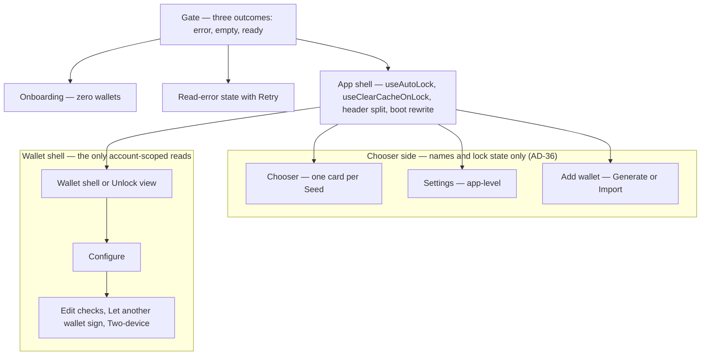
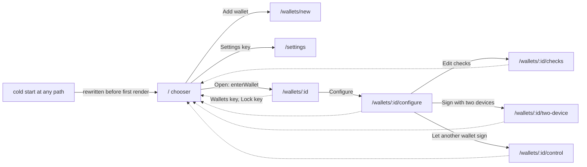
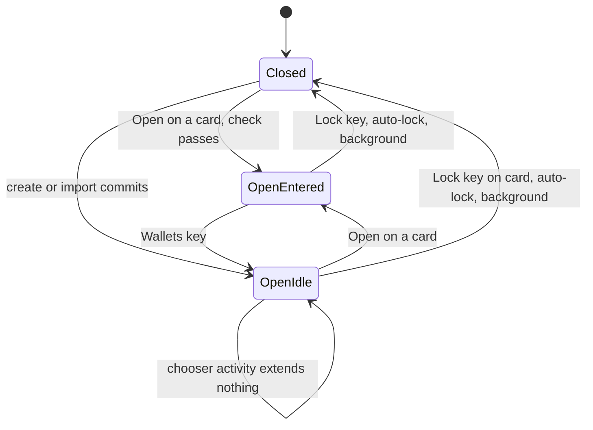

# Architecture Spine — Wallet Chooser and Per-Wallet Configuration

Inherits both parent spines (whole client AD-1..AD-17, passkey signing AD-18..AD-30) as binding and read-only. New decisions continue at **AD-31**. `[ADOPTED]` = settled by the owner (UX memlog, Resolved By The Owner, and the 2026-10-20 answers to Q1 to Q4) or by shipped code. `[ASSUMPTION]` = my call, awaiting the owner. Nothing here weakens an inherited AD; the places where it comes close are under *Conflicts For The Owner*.

## Design Paradigm

**Layered, two sealed boundaries (inherited), with the single wallet screen split into an app shell and two siblings.** The app shell is the level that exists whenever at least one Wallet exists. It owns the lifecycle that must run on every route: expiry timers, background lock, cache clearing on lock, update state. Below it sit the **chooser side** (chooser, `/settings`, add-wallet), which may read only what the store already holds, and the **wallet shell** (shell, configure, task screens), which is the only place an account-scoped read may be mounted. A wallet's name and lock state cross from chooser to shell as a walletId; nothing else does.



Route and screen map. The solid arrows are history pushes; the dashed ones unwind to the chooser (AD-33).



## Inherited Invariants

| Inherited | From parent | Binds here |
| --- | --- | --- |
| AD-1 (one-way dependencies, `[GATED]`) | main spine | Route helpers stay in `lib/route.ts`; the grouping selector and the name rule are pure and import no component. New modules join the gate lists in the same change. |
| AD-3 (sealed key boundary) | main spine | Import receives a Seed as a parameter to `keystore` only; no screen turns it into a signer. |
| AD-4 (one key factory, `[GATED]`) | main spine | The chooser side mounts no account-scoped key at all (AD-36). Any device-scoped read it needs is a named factory function. |
| AD-5 (non-extractable handle) | main spine | Unchanged. An open lock left behind by leaving a wallet holds only that handle. |
| AD-6 (one source of truth for selection) | main spine | `activeWalletId` stays the one selection field. The route carries a walletId but never owns selection (AD-32, AD-34). |
| AD-8 (three surfaces) | main spine | Rename, remove, add and Gate read failures use the declared surfaces: inline for a failed read, Annunciator for what the user did. |
| AD-10 (explorer links) | main spine | Every address on a chooser row renders through `AddressLink` with an explicit `network`. |
| AD-13, AD-14, AD-15 | main spine | A failed list or settings read is an error state, never empty, never a guard relaxed (AD-37). |
| AD-16 (single teardown owner) | main spine | Every lock, leave and remove path goes through `lib/teardown.ts` (AD-38, AD-45, AD-46). |
| AD-18 (Seed record vs Wallet view) | passkey spine | The name, the lock and the checks are properties of the Seed record; the chooser card is the Seed (AD-43). |
| AD-21 (one Open Key per lock) | passkey spine | An imported Seed gets its own lock (AD-39). |
| AD-22 (no creation path bypasses keystore and policy) | passkey spine | Import goes through `keystore`; `importAndStoreWallet` is not a path for the chooser (AD-39). |
| AD-25 (one App PIN, one failure count) | passkey spine | The chooser adds no PIN prompt and reveals nothing about attempts. |
| AD-26 (per-lock teardown; locked Wallet issues no read) | passkey spine | A locked card is its name and nothing else, enforced by type (AD-43). Leaving a wallet does not close its lock but mounts nothing for it (AD-38). |
| AD-28 (one policy function, Mainnet floor) | passkey spine | Import, auto-lock edits and every new lock pass `policy.ts` (AD-39, AD-44). |
| CLAUDE.md, `docs/agents/keys-and-secrets.md`, `ledger-io.md`, `anti-patterns.md`, `docs/decisions.md` §3, §4, §12, §13 | repo | Money as strings; no secret in state, URL or storage; every ledger read through a keyed hook; a failed read is never an empty or current one; the shell survives every lock; nothing styles `:focus`. |

## Invariants & Rules

### AD-31 — The lifecycle hooks mount above the route switch, once

- **Binds:** every route; FR-11, FR-65, AD-26
- **Prevents:** a chooser rendered outside `Main`, where `useAutoLock` and `useClearCacheOnLock` are mounted today. With nothing mounted there, no expiry timer runs on the chooser, backgrounding closes no lock, and an open Mainnet lock outlives the phone being pocketed.
- **Rule:** An **app shell** component, rendered by `Gate` whenever at least one Wallet exists, mounts `useAutoLock`, `useClearCacheOnLock`, the header, the skip link and the main region, and then switches on the route. The chooser, `/settings`, add-wallet, the wallet shell, configure and every task screen render under it. Neither hook is mounted from any child of the route switch, and `useAppUpdate` is called from the shell's header surfaces only through the shared marker predicate (AD-45).

### AD-32 — One route type; the route may name a wallet but never selects one

- **Binds:** `lib/route.ts`, `pages/`, `App.tsx`; AD-6
- **Prevents:** a route and a store that disagree (history forward to `/wallets/<id>` while `activeWalletId` is another wallet, so every hook keyed on the active wallet renders one wallet's balance under another's URL); a chooser-side screen mounted only inside the wallet subtree, as add-wallet is today.
- **Rule:**
  - `Route` is `chooser | settings | add-wallet | wallet | configure | edit-checks | two-device | control`. `home` is retired in one change, not aliased. Paths: `/`, `/settings`, `/wallets/new`, `/wallets/:id`, `/wallets/:id/configure`, `/wallets/:id/checks`, `/wallets/:id/two-device`, `/wallets/:id/control`. `parseRoute` stays total: an unknown path parses to `chooser`. A path carries a screen name and at most a walletId (the route-module rule, unchanged).
  - `isWalletScreen(route)` in `route.ts` is the only chooser-side versus in-wallet split: `wallet`, `configure`, `edit-checks`, `two-device`, `control` are in-wallet; `chooser`, `settings`, `add-wallet` are not. Every consumer (AD-35, AD-34, AD-45) calls it; none re-lists screens.
  - An in-wallet screen renders only when `route.walletId === activeWalletId`, the wallet exists, and (for configure and the task screens) its lock is open. Otherwise `resetToHome()`. The Unlock view is the wallet screen's own locked state, as shipped.
  - **Boot.** `route.ts` exports `rewriteBootLocation()`, run once at module scope before the first React render, which `replaceState`s any pathname other than `/` to `/`. It is not an effect and does not wait for `Gate`, so an in-wallet subtree can never mount from a bookmark or a reload. `[ASSUMPTION]` It also rewrites `/settings`: the shell is static and only `/` is guaranteed to be served (see Conflicts).
  - `/wallets/new` and `/settings` are rendered by the app shell, not by the wallet shell, so Add wallet works with every lock closed.
  - Tab selection inside a wallet stays local state and is not in the URL. The Settings tab renders the same app-level settings component as `/settings`; the two are never mounted together.

### AD-33 — One unwind to the chooser, driven by a depth in the history state

- **Binds:** `lib/route.ts`; Wallets key, header Lock key, Back
- **Prevents:** `leaveScreen()` (pops one entry) landing a user at the shell when they asked for the chooser; `navigate('/')` creating a chooser-to-wallet ping-pong in Back; a Lock that leaves a Back entry onto a wallet just locked; a blocked screen being left by a key that ignores the blocker.
- **Rule:** Every history entry the app pushes carries `{ screen: true, depth: n }` (`n` counts app-pushed entries above the chooser entry; an overlay entry copies its screen's depth). This extends the route module's stated "state holds one boolean" with one non-secret integer; the secret and form-data bans are unchanged. `leaveToChooser()` is the only function that returns to `/` from an in-wallet screen: it honours blockers, unwinds `depth` entries (plus the overlay entry if open) in one `history.go`, and `replaceState`s `/` when the depth is absent (an entry created by a boot). The Wallets key and the Lock key both call it; Lock closes the lock through the teardown owner first. The browser's and the phone's Back still pop exactly one entry, so Back from configure is the shell and Back from the shell is the chooser. `leaveScreen()` remains the task screens' own "work is done" exit and ignores blockers, as shipped. While a blocker is active the Wallets key is `aria-disabled` with its reason visible, and `leaveToChooser()` is a no-op (an `aria-disabled` control does not stop activation, AD-13).

### AD-34 — `activeWalletId` means selected; "entered" is derived, never stored

- **Binds:** `store/app-store.ts`, Gate, Onboarding, CreateWalletFlow, AddWalletScreen, SettingsTab, `lib/notify.tsx`; AD-6
- **Prevents:** Add wallet making a never-entered Mainnet wallet "Active"; two builders storing a second "current wallet" field; a notice about one wallet pinned over another; "Wallet removed" dismissed by the re-pick it causes.
- **Rule:**
  - `activeWalletId` is the wallet the user last **chose to open** (whether or not its lock then opened), persisted as today. It is the one selection field (AD-6) and every `useActive*` hook keeps reading it, but only wallet-side screens may call those hooks (AD-36).
  - The only writers: `enterWallet(walletId)` (sets `activeWalletId`, then `navigate` to `/wallets/<id>`; the one function the chooser's Open keys call); the removal re-pick (AD-46); Gate's repair when the persisted id no longer exists (first card in chooser order); Onboarding's first-wallet commit. `CreateWalletFlow.finishBackup` and `AddWalletScreen` stop calling `setActiveWalletId`; creation never selects.
  - `enteredWalletId(route, activeWalletId)` is one pure function: `activeWalletId` when `isWalletScreen(route)`, else `null`. It is never held in a store or state.
  - The notice scope reads `enteredWalletId`: `setNoticeWalletReader` returns it, and the scope subscription also listens to the route, so a notice raised on a chooser-side screen is untagged and survives, and a wallet's notices go when that wallet is left. The chooser's "Active" legend reads `activeWalletId` and carries no behaviour.

### AD-35 — Only the entered wallet's lock counts activity

- **Binds:** `hooks/useAutoLock.ts`, `touchActiveLock`; FR-65, AD-26, AD-21
- **Prevents:** activity on the chooser extending the last-used wallet's lock (`touchActiveLock` reads `activeWalletId`), which would turn "leaving keeps the lock open until auto-lock" into "leaving keeps it open indefinitely while the chooser is in use".
- **Rule:** `touchActiveLock` is replaced by `touchLock(enteredWalletId)`. With `null` it extends nothing: not the in-memory expiry, not the re-armed timer, and not the persisted session (`extendLockSession`). The expired-lock sweep in `onActivity`, each lock's own timer and the background close-all (FR-11) run on every route, unchanged. Time on the chooser is inactivity for every wallet. A lock opened by creating a wallet that is never entered counts down from its creation.

### AD-36 — The chooser side has a read budget of zero ledger reads

- **Binds:** chooser, `/settings`, add-wallet, the app-shell header; AD-4, AD-26, AD-10
- **Prevents:** a locked wallet's network or address leaking through a hook that resolves to the last-used wallet (`NetworkPlate`, `useActiveNetwork`); a Testnet row linked to the Mainnet explorer because `AddressLink` defaults to the active network; an account-scoped key mounted for a wallet the user is not in.
- **Rule:** The chooser side reads only `wallets` and `openLocks` from the store, through the grouping selector (AD-43). It mounts no hook that issues a ledger read, no `useActiveWallet`, `useActiveNetwork` or `useActiveNode`, no `NetworkPlate`, and no account-scoped key from the factory. Every `AddressLink` there passes `network` from its own row. The chooser makes no `lockInfo` read: the Open Check kind is on `WalletMeta`, and `Unlock` owns that read. No balance is shown. A screen-level test mounts the chooser with several open locks and fails if the query cache is non-empty or `getXrplClient` is called (parent convention: a rule governing what a screen may show gets a test that fails when it is removed).

### AD-37 — Gate has three outcomes, and a failed read is only ever the error

- **Binds:** `App.tsx` Gate; `appStateHydrationFailed`, `listWallets`; AD-13, AD-14, AD-15; CLAUDE.md failed-read rule
- **Prevents:** Onboarding offered to a user whose wallets simply could not be read (the wallet-list chain has no `.catch`, and `Gate` does not consult `appStateHydrationFailed()`); an empty chooser; and the quiet failure after a hydration error, where any store setter makes `persist` write the defaults slice over storage and erases the Address Book.
- **Rule:** Gate resolves to exactly one of: **error** (the vault list read rejects, or the persisted slice failed to hydrate), **empty** (a read that succeeded returned zero Wallets), **ready** (one or more). Error renders the `The wallets on this device could not be read. Nothing was changed.` surface with Retry, mounts neither Onboarding nor the app shell, and runs no store setter (`setWallets`, `setActiveWalletId`, `openLock`) before a successful rehydrate; Retry re-runs the vault read, and after a hydration failure it reloads the page, since hydration runs once per load. Onboarding renders only on **empty**. Neither state relaxes any guard: no screen is entered on error. `restoreOpenLocks` rejecting leaves every lock closed, which is the safe direction, and is the one sanctioned swallow.

### AD-38 — Leaving a wallet keeps its lock open and removes what it read `[ADOPTED]` for the lock

- **Binds:** `lib/teardown.ts`, `OpenWallet`, the in-wallet live hooks; AD-26, AD-16, AD-14
- **Prevents:** an open wallet's balances and history sitting warm in the query cache while the user is on the chooser and then rendering under a Live lamp on return; a live subscription surviving the shell; two builders closing the lock on leave (the owner chose not to).
- **Rule:** Leaving a wallet never calls a lock close. It unmounts the in-wallet subtree, which unsubscribes `useAccountLiveUpdates` and stops `useIncomingPaymentNotifications`, and calls the teardown owner's `leaveWallet(queryClient, walletId)` scope, which removes that wallet's account-scoped entries (`removeAccountScoped`) unless another wallet's open lock still holds the same `(network, address)`. `[ASSUMPTION]` The removal is mine, not the owner's: it costs a refetch on return and buys the same "nothing from the wallet is readable" posture a lock gives. AD-26's guarantee stands: a closed lock shows a name only; an open one may hold an Open Key and an address on its card, but no hook reads for it. No incoming-payment notice fires while on the chooser (accepted; see Deferred).

### AD-39 — Import creates its own lock, through the keystore, under the same policy as Generate

- **Binds:** `keystore.ts`, `AddWalletScreen`, `policy.ts`; AD-21, AD-22, AD-28, AD-3
- **Prevents:** a Mainnet Seed under a no-check or weaker lock; an imported Seed sharing another wallet's lock (today it is written under the active wallet's open key); the same key held twice under two locks of different strength (a classic address is identical on every network, so a Seed already on the device as Mainnet could be re-imported "as Testnet" with no Open Check); a seed or an address reaching the ledger before the duplicate is known; two import paths with two lock models.
- **Rule:**
  - `keystore.importStoredWallet(input, ctx)` sits beside `createStoredWallet` and shares its internal writer, so the order exists once: `checkWalletRequest`, duplicate check, the Signing Check credential, `createLock`, one `putStoredWallet`; any failure after the lock is written deletes the lock and discards an App PIN made for it. Input carries label, network, optional proven Node, Open Check, auto-lock, Signing Check and the Seed as a parameter; the result carries `meta` and the new lock's `openKey` and never the Seed. The caller holds the Seed in a ref and clears it in `finally`; the keystore retains none.
  - **Duplicate check first.** A Seed whose address equals the `keyAddress` of any Seed record on the device, on any network, is refused with a plain reason pointing to Configure, Other networks. It runs before any prompt, before any lock write, and before `checkBeforeImport`, so re-importing a locked wallet's Seed issues no ledger read carrying its address.
  - The policy function treats an imported Seed as at least Mainnet-strength: **Open Check `none` is refused for an import on every network** `[ADOPTED]` (a key that is imported may hold real funds this device cannot see). The Mainnet floor (Open Check required, auto-lock at least one minute) applies unchanged. **The written-Seed confirmation applies to an import exactly as to creation** `[ADOPTED]`: `requiresWrittenSeed` decides, with no import exemption, and `importStoredWallet` takes `ctx.confirmWrittenSeed` and calls it after the Seed is parsed and before any credential, lock or Wallet is written (a missing callback where it is required is `refused`, `false` is `cancelled`).
  - The new lock is opened at commit, as Generate does, and the wallet is not selected or entered (AD-34, AD-40). `importAndStoreWallet` has exactly one caller after this change, Onboarding (see Deferred); the chooser side may not call it. A test fails if it does.

### AD-40 — Both creation paths ask one set of questions and neither enters the wallet

- **Binds:** `CreateWalletFlow`, `AddWalletScreen`, Onboarding
- **Prevents:** Import growing its own copy of the Open Check, auto-lock and Signing Check questions and their `aria-disabled` reasons, which then drift from the policy; Add wallet entering a wallet it just created, including a Mainnet one; add-wallet unreachable from a chooser where every card is locked.
- **Rule:** The per-wallet questions are one extracted component rendering `describeOptions`; Generate and Import both mount it, including the written-Seed confirmation step and the Mainnet passkey-only rule (one `WrittenSeedConfirm`, fed from the caller's ref), and Import omits Seed Method and signature type (the Seed string fixes the algorithm). Neither path calls `setActiveWalletId` or navigates into the wallet: success returns to the chooser (`leaveScreen`) with the new card present. Add wallet needs no open lock: it is mounted at the app shell (AD-32) and uses no key but the one it creates.

### AD-41 — Rename is one write to the Seed record, and it is not an edit of the checks

- **Binds:** `keystore.ts`, `db.ts`, chooser rename dialog; AD-18, AD-28
- **Prevents:** a rename racing Edit checks and either aborting it (a `rev` bump changes `seedStamp`) or being lost by it; the UI writing `label` into the store directly; per-view names that disagree; an unneeded lock proof.
- **Rule:**
  - `keystore.renameWallet(seedId, name)` validates with AD-42, then writes through `mutateStoredWallet` (one transaction) as `{ ...current, label }`. It does **not** bump `rev` and asks for no lock: the name is not part of any ciphertext, lock record or compare-and-swap stamp (verified: no additional authenticated data in `lib/crypto`, and `LockRecord` carries no label), and `commitWalletEdit` rebuilds from the in-transaction row, so a concurrent edit keeps the new name.
  - It returns the `toMetas` projection of that one Seed, built from the row it wrote, and the caller replaces those entries in the store. The UI never constructs or edits a `label` itself, and the sibling views of a Seed change together because they are one projection.
  - A failed write returns a failure and changes nothing: `Could not rename the wallet. Nothing was changed.` Rename never touches the ledger.
  - The label is also the name given to a passkey when one is registered (at creation and in Edit checks). A passkey registered before a rename keeps its old name in the authenticator; the app does not and cannot change that, and no copy may promise otherwise.

### AD-42 — The name rule is one pure function

- **Binds:** `lib/wallet-name.ts`, rename dialog, both creation paths, `keystore`
- **Prevents:** the dialog and the keystore disagreeing about what a valid name is; two Seeds that a locked card cannot tell apart (a locked card has only its name, AD-26).
- **Rule:** `validateWalletName(raw, others)` is the only place the rule lives. Normalise: NFC, trim, collapse inner whitespace. Valid: 1 to 40 code points `[ASSUMPTION: limit]`; not equal, compared case-insensitively on the normalised form, to the name of any **other Seed** (sibling views share a name and never collide). It returns a verdict with a reason code; the strings are the UX spine's. The UI renders the verdict; `renameWallet` and both creation functions re-run it against the stored records (a best-effort guard across tabs, not a security boundary). An unchanged name closes the dialog with no write. Creation applies the same rule and replaces an empty or colliding default with an auto-suffixed one (`uniqueDefaultName`, same module) `[ASSUMPTION; UX OQ-8]`. Existing duplicates are grandfathered and checked only when changed.

### AD-43 — One card per Seed, computed by one pure selector, with a locked card typed to carry a name only

- **Binds:** `src/store/wallet-groups.ts`, chooser, Open and Configure keys; AD-26, AD-18
- **Prevents:** a locked card rendering a network or address because a builder had the whole `WalletMeta` to hand; card order changing with storage order (the `wallets` store is keyed by random UUID, so `getAll` order is unrelated to creation); Configure acting on a Seed with no view; two groupings.
- **Rule:**
  - `groupWalletsBySeed(wallets, openLocks, activeWalletId)` is the only grouping. Order is Seed `createdAt` ascending, then `seedId`, never storage order and never by state.
  - Its output is a discriminated union. The **locked** variant carries `seedId`, `lockId`, `label` and `entryWalletId` and nothing else: no address, network, Node or check kind. The **open** variant carries `label`, `lockId`, whether the Open Check allows Lock, and one row per view (`walletId`, `network`, `address`, Node presence). The component cannot render what the type does not hold.
  - Open and Configure always carry **one walletId**, never a `seedId`. The entry view is the group's view equal to `activeWalletId` if it has one, else the first view (the one whose `walletId` equals `seedId`, else earliest). `[ASSUMPTION; UX OQ-14]` A multi-row card has one Configure key acting on that view; a per-row Configure is deferred.
  - After unlocking a Seed with more than one view the app returns to the chooser through `leaveToChooser()`, so Mainnet is never entered by default `[ASSUMPTION; UX OQ-6]`; a single-view Seed stays in its shell.

### AD-44 — Auto-lock is edited in per-wallet configuration, by the one writer that re-proves the Open Check

- **Binds:** Configure Checks plate, `EditChecksScreen`, `SettingsTab`, `keystore.setLockAutoLock`; AD-26, AD-28, FR-65
- **Prevents:** an app-level auto-lock control that edits some lock with no wallet in context; two success paths for a minutes change (one refreshing `lockInfo`, one not); a shared lock changed for sibling wallets without saying so.
- **Rule:** Settings loses auto-lock and Lock now. The Checks plate edits minutes through `setLockAutoLock`, which goes through `editChecks`: the lock's Open Check is passed again and the policy floor is checked over every Wallet on the lock. The plate and Edit checks share one success handler (`setLockMinutes` plus invalidating `queryKeys.lockInfo(lockId)`). A lock shared by more than one Seed (every legacy Wallet) says so on the plate, with the count from the store, because the change applies to all of them. `app-store.autoLockMinutes` remains the legacy migration input only and is never read or written by a screen.

### AD-45 — The header splits in two, and every lock close goes through the teardown owner

- **Binds:** `AppHeader`, Lock keys, the update marker; AD-16, AD-26, `docs/decisions.md` §6.12
- **Prevents:** the wallet `Select` surviving (switching without seeing the chooser's network words); `NetworkPlate` mounted on a chooser-side screen; a Lock key calling `closeLock` directly (as `AppHeader` does today) and skipping the cache removal; the update marker derived twice.
- **Rule:** The wallet `Select` is removed; switching is the Wallets key, then Open. A **wallet header** (nameplate, Wallets key, and only for an open lock: `NetworkPlate`, Configure, and Lock when the Open Check is not `none`) renders when `isWalletScreen(route)`; a **chooser header** (nameplate, Settings key) otherwise. A locked wallet's header carries the Wallets key alone. Every Lock key, header or card, calls `tearDownLock`. The update marker is read from one shared predicate (`updateReady && !declined`) by the chooser's Settings key and the Settings tab; neither re-derives it. `docs/decisions.md` §6.12 is updated with the picker's removal.

### AD-46 — Remove re-checks its lock at call time and tears down through the owner

- **Binds:** chooser Remove, Remove all, `lib/teardown.ts`, `keystore.removeWallet`; AD-13, AD-16, AD-26
- **Prevents:** a Remove that proceeds on a locked wallet because `aria-disabled` does not stop activation; a lock closed or a cache cleared inline in a component (`closeLock`, `queryClient.clear()` today); `activeWalletId` pointing at a removed wallet; a closed-by-removal lock whose session lingers.
- **Rule:** The Remove handler re-reads `lockId in openLocks` at call time and refuses otherwise; the key being `aria-disabled` with its reason is the presentation, not the guard. Removal calls one teardown-owner scope, `removeWalletData(queryClient, removed, remaining)`: it removes the removed wallet's account-scoped entries, closes a lock the keystore deleted with the Seed's last view (never the legacy lock), and, when no Wallet remains, runs `tearDownAllLocks`. The new `activeWalletId` comes from one pure function (keep it if still present, else the first card in chooser order, else `null`). Removing a view removes only that view; the dialog states which of its three bodies applies. Remove all wallets from this device stays `tearDownAllLocalState` from app-level Settings, which depends on no wallet and no open lock, so a hard-locked user can reach it from the chooser's Settings key. Removing the last wallet returns the app to Onboarding through Gate's empty outcome.

## Lock Lifecycle



`OpenIdle` mounts no account-scoped read and no timer extension; its only way out other than Open is expiry. `OpenEntered` is the only state in which activity moves an expiry (AD-35).

## Consistency Conventions

| Concern | Convention |
| --- | --- |
| Naming | Routes and screens as in AD-32. The chooser card is a **Seed card**; its rows are **network rows**. UI words are the PRD glossary's. |
| Ids | A route carries a walletId (a view), never a `seedId`, a lock id or a name. A card operation that must name a Seed passes a `seedId` in memory only. |
| Selection | One field, `activeWalletId`; one derived value, `enteredWalletId(route, activeWalletId)`. |
| Store writes | A screen never writes a `WalletMeta` field. Label and lock changes come from a keystore result (AD-41, AD-44). |
| Teardown | Lock, leave and remove call `lib/teardown.ts` scopes only (AD-38, AD-45, AD-46). |
| History | `navigate`, `leaveScreen`, `leaveToChooser`, `pushOverlay` only; no direct `history.*` call outside `route.ts`. |
| Failed read vs empty | Gate error is its own surface (AD-37); a card list is never derived from a failed read. |
| Tests | Each of AD-31, AD-35, AD-36, AD-37, AD-39 gets a test that fails when the rule is removed (parent convention). |

## Stack

No new dependency. Everything is on the parents' pinned stack; the route module stays dependency-free.

## Structural Seed

```text
src/lib/route.ts            # Route type, isWalletScreen, rewriteBootLocation, leaveToChooser, depth state
src/lib/wallet-name.ts      # validateWalletName, uniqueDefaultName (pure)
src/lib/teardown.ts         # + leaveWallet, removeWalletData scopes
src/lib/crypto/keystore.ts  # + importStoredWallet, renameWallet (shared writer with createStoredWallet)
src/store/wallet-groups.ts  # groupWalletsBySeed (pure; discriminated card output)
src/store/app-store.ts      # touchLock(enteredWalletId); enterWallet; enteredWalletId selector
src/pages/AppShell.tsx      # lifecycle hooks, header split, route switch (replaces most of Main)
src/pages/Chooser.tsx       # chooser side
src/pages/Configure.tsx     # per-wallet configuration
```

Deployment and operations are unchanged (parent AD-17): a static shell, only `/` guaranteed served, hence the boot rewrite in AD-32.

## Capability → Architecture Map

| Area | Lives in | Governed by |
| --- | --- | --- |
| Chooser, one card per Seed | `store/wallet-groups.ts`, `pages/Chooser.tsx` | AD-36, AD-43, AD-26 |
| Open, leave, Back, boot | `lib/route.ts`, `pages/AppShell.tsx` | AD-32, AD-33, AD-34 |
| Lock stays open on leave; auto-lock | `hooks/useAutoLock.ts`, `lib/teardown.ts` | AD-31, AD-35, AD-38 |
| Add wallet: Generate and Import | `keystore.importStoredWallet`, `createStoredWallet`, `AddWalletScreen` | AD-39, AD-40, AD-28 |
| Rename | `keystore.renameWallet`, `lib/wallet-name.ts` | AD-41, AD-42 |
| Per-wallet configuration and auto-lock | `pages/Configure.tsx`, `setLockAutoLock` | AD-44, AD-28 |
| Remove, Remove all | `lib/teardown.ts`, chooser, Settings | AD-46, AD-16 |
| Gate, read-failure states | `App.tsx` | AD-37, AD-13..AD-15 |
| Header, update marker | `AppHeader` split, shared predicate | AD-45 |

## Conflicts For The Owner

None of these is applied as an override.

- **RESOLVED (owner Q1): flagging Mainnet on the chooser against AD-26.** A locked card shows the name only; AD-26 is unamended. AD-43 makes it a type.
- **CONFLICT (near): the route carrying a walletId against AD-6.** AD-6 keeps selection in the store. AD-32 and AD-34 keep it there and make the route an input that must agree, never a second owner. No AD is weakened.
- **DEVIATION from the UX spine (not from an inherited AD): `/settings` on a cold start.** UX keeps `/settings` on boot and rewrites everything else; AD-32 rewrites it too, because only `/` is guaranteed to be served by the static shell and the owner's rule is "always the chooser". `[ASSUMPTION]` Reversing it needs a served `/settings`.
- **DEVIATION from the UX spine: Lock inside a wallet "replaces the entry with `/`".** AD-33 uses `leaveToChooser()` instead, which leaves no dead entry. `[ASSUMPTION; UX OQ-11]`.
- **Existing drift, reported and not fixed here:**
  - Onboarding imports under the legacy lock through `importAndStoreWallet`, against AD-21 and AD-22 (which says that function is removed).
  - `Unlock.tsx`'s full reset against AD-25 (a hard lock must not wipe passkey-only Wallets), which the passkey spine already says to rewrite.
  - `AppHeader` closes locks with `closeLock` directly rather than through the teardown owner (corrected by AD-45).

## Open Questions For The Owner

Non-blocking; each is also under Deferred.

- **Q5.** Changing auto-lock on a wallet that shares the legacy lock changes it for every wallet on that lock (AD-44 discloses it). Acceptable?
- **Q6.** Should first-run Onboarding import get its own lock, as Add wallet does?
- **Q7.** Removing the last wallet leaves the App PIN on the device. Acceptable?

## Deferred

- **Q5, shared-lock auto-lock.** Ships as disclosed in AD-44. Revisit on the owner's answer, or if a Mainnet wallet is found sharing a lock with one the user wants left alone.
- **Q6 and Onboarding import on the keystore path.** Onboarding keeps `importAndStoreWallet` under the legacy lock; two import lock models coexist until it moves. Revisit when first-run is next changed, or before any owner asks that first-run import match Add wallet. Then delete `importAndStoreWallet`.
- **The AD-25 rewrite of the hard-lock reset in `Unlock.tsx`.** Pre-existing; revisit with the passkey plan's reset story. The chooser adds no new path into it.
- **Incoming-payment notices while on the chooser.** None fire, because the subscription lives in the wallet shell (AD-38). Revisit if the owner wants background notices: it needs a subscription owner outside the shell and a per-lock read budget decision under AD-26.
- **A per-row Configure key on a multi-view card** (UX OQ-14). Revisit when a Seed with two views shows the single Configure key to be ambiguous in use.
- **Balances on the chooser** (UX OQ-7). Needs an account-scoped read for an unentered wallet, which AD-36 forbids; revisit only with an owner decision on that read.
- **Duplicate-name enforcement for wallets created before this change** (UX OQ-8). Grandfathered by AD-42; revisit if a collision is reported.
- **Q7, the App PIN after the last wallet is removed.** Today it stays with the legacy vault records; Onboarding then runs as shipped. Revisit on the owner's answer.
- **A lint gate for AD-36.** A screen-level test pins it now; a scan like `check-query-keys.mjs` over the chooser files is possible once the file layout settles.
