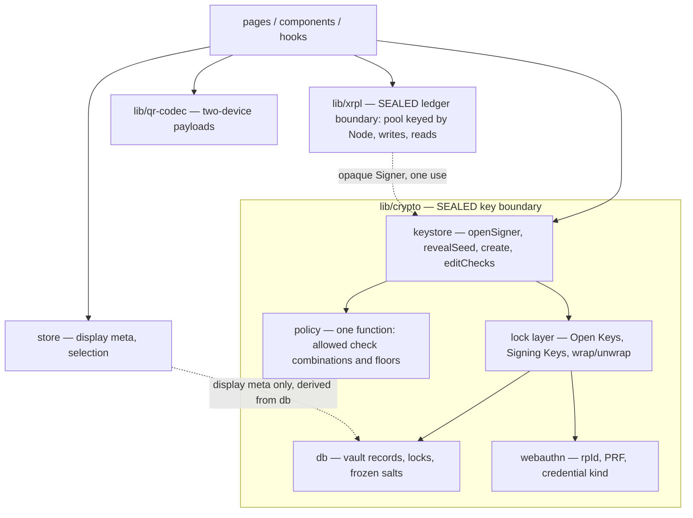
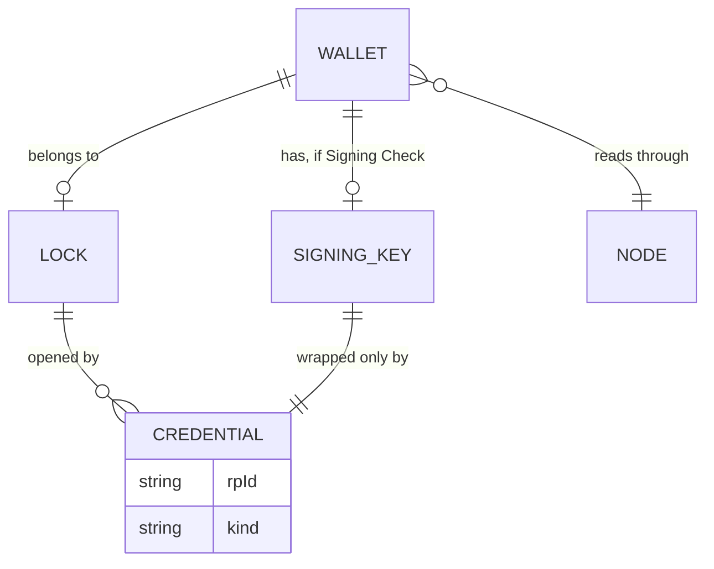

# Architecture Spine — Per-Wallet Key Setup and Signing Checks

Inherits the parent spine (`architecture-xrpl-wallet-2026-09-12`, AD-1..AD-17)
as binding. New decisions continue its numbering at **AD-18**. Five parent ADs
cannot hold as written; they are listed under *Inherited Invariants* as
**conflicts** and need a parent amendment before this spine is final. Nothing
here overrides them silently.

`[ASSUMPTION]` marks a call not yet confirmed by the owner. Finalized with four still open: Regular Key replacement (AD-29), migration across networks (AD-27), Controlled Wallet identity (AD-18), a missing `network_id` (AD-19). The six conflicting parent ADs (AD-2, 3, 5, 6, 9, 16) are amended when this spine is adopted.

## Design Paradigm

**Layered, two sealed boundaries (inherited), with the key boundary reshaped as a
sealed signing service.** Nothing outside `src/lib/crypto/` ever holds a Seed or
a signer; it is handed a signed blob. Key material is organised as **locks**:
one lock per Wallet by default, each with its own Open Key, its own session
expiry, and an optional Signing Key that the session can never reach.



`xrpl` never imports `crypto`. `ks` hands the caller an opaque one-use `Signer` (AD-22) that satisfies a structural type declared in `lib/xrpl/writes.ts`; the caller passes it to `submitAndClassify`, so neither boundary imports the other.

## Inherited Invariants

| Inherited | From parent | Binds here |
| --- | --- | --- |
| AD-1 (one-way dependencies, `[GATED]`) | parent spine | `crypto` collects PINs and passkey prompts through a callback (`prompts`), never by importing UI. `qr-codec` is a `lib` leaf. The gate scripts' module lists are updated in the same change as any new module. |
| AD-4 (one query-key factory, `[GATED]`) | parent spine | Keys remain (name, network, Account address). A locked Wallet issues no read at all (AD-26). |
| AD-7 (money in one module) | parent spine | Unchanged; the QR codec carries tx JSON with drops as strings and never parses an amount. |
| **AD-9 — CONFLICT** | parent spine | Today `submitAndClassify` takes a `Wallet` and autofills, cap-checks, signs and submits in one call. It must take a `Signer` (AD-22) and order the Signing Check before the ledger window is fixed. Parent AD-9 needs an amendment. `SetRegularKey`, `AccountSet` and every two-device submission still pass through it. |
| AD-12 (test seam for external resources) | parent spine | Moves to the Node-keyed pool (AD-20); WebAuthn is also an external resource and gets the same seam (AD-24). |
| AD-13 (guards fail closed) | parent spine | FR-77 and FR-76 guards read live `account_info`; an errored read blocks, never permits. |
| Parent Deferred: user-editable endpoint, regular-key rotation | parent spine | Both are now built (FR-61, FR-75/76); strike them from the parent's Deferred list on adoption. |
| AD-14, AD-15 | parent spine | A Wallet's master-key and Regular Key state renders as unknown on a failed read, never on or off. |
| **AD-2 — CONFLICT** | parent spine | Egress is "closed", but FR-61 adds a user-supplied Node and Devnet adds a faucet. Resolved by AD-20; parent AD-2 needs an amendment. |
| **AD-3 — CONFLICT** | parent spine | `unlockWalletForSigning` returns a live `Wallet` to screens, so the Seed outlives one signature and a screen decides whether to run the check. Resolved by AD-22; parent AD-3 needs tightening. |
| **AD-5 — CONFLICT** | parent spine | One non-extractable `vaultKey` for all Wallets. FR-65 needs one per lock with its own expiry. Resolved by AD-21; parent AD-5's handle rule is kept, its "one" is not. |
| **AD-6 — CONFLICT** | parent spine | `app-store` holds one app-wide `network`. FR-61 makes it a Wallet field. Resolved by AD-19. |
| **AD-16 — CONFLICT** | parent spine | Teardown has two sets. Per-Wallet auto-lock (FR-65) needs a third scope, and a PIN hard lock must stop wiping passkey-only Wallets (FR-68). Resolved by AD-25 and AD-26. |

## Invariants & Rules

### AD-18 — A Wallet is a view of one Seed on one network; the vault record owns its configuration

- **Binds:** FR-60, FR-64, FR-73, FR-75, every read and every display of an address
- **Prevents:** one builder keying balances by the key's own address and another
  by the Account address, which diverge the moment FR-75 makes a Wallet sign for
  an Account it does not derive. Also prevents the UI and the keystore holding
  two answers to "does this Wallet have a Signing Check?".
- **Rule:** A **Seed record** (`seedId`) owns the ciphertext, the lock, the
  checks and the algorithm. A **Wallet** is `(walletId, seedId, network, node)`;
  selection state is the `walletId`, never an address. Its ledger identity is
  `(network, accountAddress)`. The address the key itself
  derives is stored as `keyAddress`, used only to detect a wrong credential
  (AD-24) and to choose how to sign. A signer for a Wallet whose `keyAddress`
  differs from its Account is built with `Wallet.fromSeed(seed, { algorithm,
  masterAddress })`. The record in `lib/crypto/db` is the single owner of: Seed
  Method, algorithm, `keyAddress`, Open Check kind, Signing Check kind, lock id,
  and frozen salts. `app-store` persists display meta only (label, network, Node,
  Account address, check kinds), derived from that record and never edited
  independently. Every edit carries a record `rev` and is a compare-and-swap inside its
  IndexedDB transaction, so two tabs or two flows cannot lose each other's update.
- **Controlled Wallets (FR-75), `[ASSUMPTION]`.** The Wallet whose key becomes an
  Account's Regular Key operates that Account: its `accountAddress` is the
  controlled Account, its `keyAddress` its own. A Controlling Wallet on this
  device has `keyAddress` equal to that `accountAddress`. Two Seed records can
  share `(network, accountAddress)` and **must differ in `keyAddress`**; creation
  rejects a duplicate triple. Sharing a query key set is correct (one ledger
  Account); per-record state is never keyed by address. A Controlling Wallet on
  an offline device has no record here: the controlled record keeps only its
  `controllerAddress`, display-only.
- **Legacy `algorithm` (FR-74).** Not backfilled by guessing. A legacy Seed's
  `algorithm` is `unresolved` until its first decryption, then derived from the
  Seed, checked against the stored address, and stored.

### AD-19 — Network and Node are fields of the Wallet `(amends parent AD-6)`

- **Binds:** FR-60, FR-61, FR-41, FR-39, FR-40
- **Prevents:** two components disagreeing about the active network after a
  switch, and a Mainnet Wallet read through a Testnet Node.
- **Rule:** `NetworkId` gains `devnet`, and `NETWORKS` carries a built-in Node
  list per network (first entry is the default, FR-60). `network` and `node` are
  set at creation and live on the Wallet
  record. `app-store`'s app-wide `network` is removed; the active network is
  derived from the active Wallet by one selector. Query keys keep
  `(name, network, Account address)`; the Node is **not** in the key, because
  two Nodes of one network serve one ledger. The Address Book keeps network in
  its identity (parent AD-6). Mainnet remains unmistakable wherever a Wallet's
  network is shown (FR-39).

### AD-20 — The pool is keyed by Node; a Node is trusted only after it proves its network `(amends parent AD-2)`

- **Binds:** FR-61, FR-40, FR-41, `lib/xrpl/client.ts`, `lib/xrpl/faucet.ts`
- **Prevents:** a Testnet Node answering for a Mainnet Wallet, a custom Node
  becoming a silent second egress path, and failover hopping to a Node the user
  never chose.
- **Rule:** `client.ts` pools connections by Node URL, not by network id. A
  custom Node is accepted only after `server_info` answers with the `network_id`
  of the network the user picked (Mainnet 0, Testnet 1, Devnet 2). A Node that
  reports no `network_id` is accepted for Mainnet only (`[ASSUMPTION]`, verify
  against a live Mainnet Node before building). `submitAndClassify` and every
  read take the Wallet's Node, not just its network. A custom Node is
  stored only on that Wallet's record. Failover happens only within the built-in
  list; a custom Node has none. The AD-12 seam (substitute + reset) moves with
  the pool. **Egress, as amended:** built-in Nodes, the Testnet and Devnet
  faucets in `lib/xrpl/faucet.ts`, the Release Manifest, and one new category — a
  user-declared Node that exists on a Wallet record after passing the test. No
  other user-supplied host is ever contacted.

### AD-21 — One Open Key per lock; keys are domain-separated and their derivation inputs are frozen

- **Binds:** FR-65, FR-66, FR-68, FR-70, FR-71, FR-73, FR-74
- **Prevents:** a shared group key that keeps a Wallet openable after its own
  auto-lock fired; two purposes or two Wallets sharing derived key material; a
  refactor that recomputes a salt from a constant and silently strands funds.
- **Rule:** A **lock** is a random Open Key wrapped under that lock's Open Check
  credential. A new Wallet always gets its own lock. The session holds one
  non-extractable Open Key per unlocked lock, each with its own lazy expiry
  (parent AD-5's window and rule, applied per lock). Derivation is
  domain-separated by `(lockId | walletId, purpose)` where purpose is `open`,
  `sign` or `seed`. For the App PIN there is one PBKDF2 over the PIN with a
  device salt, then HKDF per `(id, purpose)`. For a passkey, a distinct PRF salt per `(walletId, purpose)`, one credential per assertion. The `seed` salt is the exception to storing a random salt (AD-24). Every PRF salt and
  every HKDF `info` string is **generated at creation and stored with the
  record**; code never recomputes one from a constant. The legacy `PRF_SALT` and `HKDF_INFO` (constants today) and PBKDF2 parameters are copied into the legacy lock record at migration, so the rule holds for every Wallet from then on. PBKDF2 output is never cached beyond one unwrap, and each purpose derives its own, so the session cannot obtain a Signing Key from retained bits. The lock layer owns an expiry timer per lock that fires the AD-26 teardown; expiry is checked lazily on read as well (parent AD-5), never only lazily. An Open Check of "none"
  (Testnet and Devnet only) stores the Open Key as a non-extractable `CryptoKey`
  in IndexedDB, which parent AD-5 permits; it is rejected for Mainnet by AD-28.

### AD-22 — No signer and no Seed leaves `lib/crypto` except through reveal; the choke point takes a one-use Signer `(tightens parent AD-3, amends AD-9)`

- **Binds:** FR-66, FR-67, FR-69, FR-18, FR-24, every signing and reveal path
- **Prevents:** a screen that signs without running the Wallet's Signing Check, a
  Seed that outlives one signature, a check prompt that outlasts the ledger
  window of a transaction prepared before it (autofill gives about one minute; a
  prompt can wait that long), and a creation or import path that bypasses policy.
- **Rule:** `keystore.openSigner(walletId, role, prompts)` runs that Wallet's
  Signing Check inside `lib/crypto` and returns an opaque `Signer` whose only
  methods are `sign(tx)` and `dispose()`, valid for one signature, holding the
  Seed only in a closure cleared in `finally`. `Signer` is a structural type
  declared in `lib/xrpl/writes.ts`, so `xrpl` does not import `crypto`.
  `submitAndClassify` takes a `Signer` instead of a `Wallet` and runs, in order:
  autofill and fee cap (the fee is shown first, FR-18) → confirm step (FR-20) →
  `openSigner` (the check) → **set `LastLedgerSequence` from the current
  validated ledger** → `sign` → submit. The window is never fixed before a
  prompt. `unlockWalletForSigning` is removed.
- **The one sanctioned exit.** `revealSeed(walletId, prompts)` runs the same
  check and returns the Seed string to the reveal screen only, which holds it in
  a ref and clears it (parent AD-3). No other function returns a Seed.
- **Every creation, import and edit goes through `keystore`** (`create`,
  `import`, `editChecks`), which call the policy function (AD-28). The legacy
  functions that take a session key (`generateAndStoreWallet`,
  `importAndStoreWallet`) are removed. The check is never skipped for any
  transaction type, including `SetRegularKey` and `AccountSet` (FR-66
  `[ASSUMPTION]`). PIN and passkey are collected through `prompts` (parent AD-1).

### AD-23 — A Signing Check is structural: the session key cannot open the Seed

- **Binds:** FR-66, FR-67, FR-72
- **Prevents:** the for-show prompt — a sign-time passkey or PIN request while
  the unlocked session could still decrypt every Seed.
- **Rule:** A Wallet with a Signing Check has its Seed encrypted under a random
  **Signing Key** wrapped **only** under the signing credential, domain
  `(walletId, 'sign')`. The Signing Key never enters session state, any store, or
  the IndexedDB session store, and is never derivable from an Open Key. A
  Standard Wallet's Seed is encrypted under its lock's Open Key. A Seed's ciphertext exists in **exactly one form**: any edit that adds a Signing Check deletes the older ciphertext, including a legacy `encryptedSeed` under `vaultKey`, in the same transaction (AD-28). A tab still running an older build then finds no record and fails closed. A signing check is proven by decrypting the wrapped Seed. The property to test: with the app
  unlocked and the Wallet's Open Check passed, no code path yields that Wallet's
  Seed without the Signing Check succeeding.

### AD-24 — A Passkey-Derived Seed is computed, never stored; its rpId is explicit and recorded

- **Binds:** FR-62, FR-63, FR-70, FR-71, FR-72
- **Prevents:** a seed that silently changes when a refactor touches the
  derivation, a domain change that strands funds with no record of what rpId was
  used, and a wrong passkey being treated as the right one.
- **Rule:** `Seed = Wallet.fromEntropy(HKDF(PRF(frozen 'seed' salt)), { algorithm })`,
  computed per signature or reveal and never persisted in any form. **The `seed` salt is reconstructible by the user, not device-stored:** it is `SHA-256('xrpl-bench:seed:v1' | ordinal)` where `ordinal` is a short number the app shows once at creation and the user writes down with the Wallet's name; it is public, not secret. Otherwise a lost phone could never reproduce the Seed and FR-62's "same passkey on a new phone = same wallet" would be false. `keystore.restorePasskeyWallet(ordinal, algorithm, network, node, prompts)` rebuilds the Wallet and accepts it only if the derived address matches (`[ASSUMPTION]`: ordinals are unique per credential). The HKDF
  output is exactly 16 bytes, because `fromEntropy` uses only the first 16 of
  whatever it is given and a longer value would suggest entropy that is
  discarded. A derived
  address that does not equal the stored `keyAddress` is a wrong credential and
  is rejected; this is the equivalent of "decrypting known ciphertext" for a
  Seed with no ciphertext, and `CLAUDE.md`'s unlock wording must be amended to
  say so. `lib/crypto/webauthn.ts` sets `rp.id` explicitly through one function from the build's configured origin (set per branch, since an rpId must match the page's origin, so dev, stage and prod each have their own), never from `location.hostname` implicitly, and every credential record stores the rpId it was registered under (today
  `rp` has only `name`, so it defaults to the current host; credentials already
  registered get the host they were registered under at migration). PRF is
  capability-detected per credential; an unsupported device shows the option
  `aria-disabled` with the reason (FR-60). An authenticator may skip PRF evaluation during registration, so creation
  treats a second prompt right after registration as the normal path, and
  confirms the derived address before the Wallet is saved. The passkey kind
  (synced vs device-bound) is read from the backup-eligible flag at registration
  (`getAuthenticatorData()` on the attestation response); only BE is stored,
  because it is permanent while the backup-state flag can change later. PRF
  support is uneven across providers and has had regressions, so it is
  capability-detected per credential and verified on real devices, not assumed. WebAuthn is an external resource with a substitution and
  reset seam (parent AD-12).

### AD-25 — One App PIN, one failure count, a hard lock that never wipes a passkey-only Wallet

- **Binds:** FR-65, FR-68, FR-9, FR-72
- **Prevents:** two builders counting PIN failures per lock or per purpose, so
  the lockout becomes bypassable by alternating; and a hard-lock reset that
  destroys Wallets that never used a PIN.
- **Rule:** The App PIN is created the first time any Wallet chooses a PIN check
  and does not exist otherwise. The failure count lives with the PIN, not with a
  lock, and is shared by every Open Check and Signing Check that uses it. A wrong PIN counts, a wrong passkey (presented but failing the check) counts as it does today, and a cancelled or dismissed passkey prompt never does. One function, `pin.verifyPin`, owns the counter and increments it inside an IndexedDB transaction, so parallel guesses cannot share one count. The
  prompt states tries remaining. A hard lock disables PIN derivation for every PIN-using Wallet and **deletes nothing by itself**: removal needs a separate explicit confirmation, and then removes only Seed records whose **every** unlock path is the PIN. Check kinds include `either` (the legacy lock, openable by passkey or PIN), so a legacy Wallet survives a hard lock and opens by passkey. `Unlock.tsx`'s whole-vault reset is rewritten to this rule; a full reset stays its own explicit action (parent AD-16). A Passkey-Derived Seed Wallet whose Open
  Check is the PIN remains recoverable through its passkey (FR-68).

### AD-26 — Teardown has a per-lock scope; a locked Wallet issues no read `(amends parent AD-16)`

- **Binds:** FR-65, FR-12, `lib/teardown.ts`, every hook that reads for the active Wallet
- **Prevents:** a Wallet staying readable after its own auto-lock, and a lock
  that deletes another lock's data.
- **Rule:** `lib/teardown.ts` owns three scopes: **per-lock** (drop that lock's
  session key and remove the account-scoped query data of its Wallets),
  **account data** (vault, cache, sockets, persisted store — full reset), and
  **shell** (never removed by a lock). A Wallet whose lock is closed shows its
  label only; the AD-4 factory read is not enabled for it, so no request carries
  its address. The first read after unlock uses a fresh query, not retained data
  (parent AD-14). Auto-lock on backgrounding (FR-11) closes every lock. Query data for an Account is removed only when no other open lock holds a record for it (AD-18). Each lock's auto-lock minutes live on the lock record (the legacy lock takes today's persisted `autoLockMinutes` at migration); `app-store`'s single `autoLockMinutes` is removed. The app-wide `Unlock` gate is replaced by a per-Wallet unlock prompt, since the app itself opens without a check (FR-65); `auth.ts` is replaced by `lock.ts`.

### AD-27 — Existing Wallets migrate by relabelling, not re-encrypting; rollback degrades only new data

- **Binds:** FR-74, FR-48, `lib/crypto/db.ts`, `store/app-store.ts`
- **Prevents:** a migration that touches every Seed in one step, which a crash or
  a rollback turns into a vault nobody can open.
- **Rule:** Every existing Wallet joins one **legacy lock** whose Open Key *is*
  today's `vaultKey`, wrapped as today under the PIN and the passkey. Nothing is
  re-encrypted on update. A Wallet leaves the legacy lock only through an FR-73 edit, which re-encrypts that Wallet alone and **deletes its legacy `encryptedSeed`** (AD-23); the confirm says an older build can no longer open it. Each legacy Wallet's `network` is set at migration from today's persisted app-wide `network`, and the Wallet list offers "use on another network", which adds a Wallet over the **same Seed record** (AD-18) so a funded Mainnet address is never lost from view by a Testnet default (`[ASSUMPTION]`; product-adjacent, to confirm). Migrated Wallets lock
  together, as today. There is **no IndexedDB version bump**: new data is
  additive fields on existing records and new `lock:<id>` keys in the existing
  `vault` store, and a legacy Wallet's `encryptedSeed` is never rewritten
  in place. A rollback of the deployed build therefore loses only Wallets created or edited on the new build, and never touches an unedited legacy Wallet. The persisted `app-store` version stays 0 and the
  new fields are normalised in `merge`, as Epic 9 did. The update applies only
  when the user accepts it (FR-48).

### AD-28 — One policy function decides which check combinations are legal; edits are atomic

- **Binds:** FR-60, FR-63, FR-65, FR-67, FR-72, FR-73
- **Prevents:** the creation screen and the edit screen enforcing different
  rules, a Mainnet Wallet with no Open Check slipping in through an edit, and a
  failed edit leaving a Wallet with neither the old nor the new Seed encryption.
- **Rule:** `lib/crypto/policy.ts` is the only code that says what is allowed. It
  encodes the FR-67 table (Passkey-Derived Seed ⇒ passkey Signing Check only),
  FR-65's Mainnet floor (Open Check required, auto-lock ≥ 1 minute), FR-72's
  written-Seed confirmation for a Mainnet Wallet whose only check is a passkey
  (`[ASSUMPTION]` as defined in FR-72), and "Open Check none only off Mainnet".
  Creation, import and edit all call it; the UI only renders its answer, including the
  reasons for an `aria-disabled` option. An edit requires the current check that
  the change affects (FR-73), writes the new encryption and removes the old in
  **one IndexedDB transaction**, and leaves the old record untouched on any
  failure. The Seed Method is never an editable field.

### AD-29 — Regular Key and master-key state is read from the ledger, never remembered

- **Binds:** FR-75, FR-76, FR-77
- **Prevents:** a local flag saying "this Wallet is controlled" or "master key
  off" that drifts from the ledger, and a guard satisfied by a failed read.
- **Rule:** An Account has exactly one Regular Key (verified, xrpl.org
  `SetRegularKey`). Whether it is set, and whether `lsfDisableMaster` is set,
  come from `account_info` through the AD-4 factory and are never persisted. A
  Wallet counts as controlled only after the `SetRegularKey` is **validated**
  (FR-22), not on submission. `SetRegularKey` and `AccountSet`
  (`asfDisableMaster`) are enabled only on a current successful read (parent
  AD-13), pass `submitAndClassify`, and are signed through `openSigner`.
  FR-76 sets the Account's single Regular Key; `[ASSUMPTION]` when one already
  exists it is replaced behind a confirm step that names the old key as no longer
  able to sign. A controlled Wallet signs with `masterAddress` set (AD-18).
- **Which key signs which transaction.** Disabling the master key
  (`asfDisableMaster`) must be signed by the Account's own master key pair
  (xrpl.org), so it is offered only through a Wallet that holds that key: the
  Controlling Wallet, or the Wallet whose `keyAddress` equals its Account. A
  Wallet that signs as a Regular Key never offers it. Re-enabling
  (`ClearFlag`) is signed by the Regular Key. `openSigner` is told which role to sign as; the caller never infers it.

### AD-30 — Two-device signing has one codec, and the online side verifies what comes back

- **Binds:** FR-78
- **Prevents:** two builders defining incompatible QR payloads, an offline device
  signing a transaction with a window too short to round-trip, and the online
  device submitting a blob that is not what it asked for.
- **Rule:** `lib/qr-codec` owns both payloads — unsigned: `version`,
  `network_id` (an envelope field — the ledger's `NetworkID` transaction field
  exists only above 1024), transaction JSON; signed: `tx_blob`. The online device builds the
  transaction (the offline device cannot read Sequence or Fee) and sets
  `LastLedgerSequence` explicitly to validated ledger + 75, roughly four to six
  minutes (not a promised duration, so the UI states the expiry as a window);
  xrpl.js `autofill` gives +20, which is too short. The offline device signs
  through `openSigner` and refuses a `network_id` that is not its Wallet's.
  Before submitting, the online device decodes the returned blob with xrpl's `decode` and refuses it unless it deep-equals the unsigned transaction it sent, ignoring only `SigningPubKey` and `TxnSignature`, and the signing key belongs to the expected Account (master or Regular Key). The offline device cannot run live-read guards (parent AD-13): the online device runs them before building, and the offline device shows the decoded fields for the confirm step (FR-20).
  Submission goes through `submitAndClassify`; expiry reports as expired (FR-24).

## Consistency Conventions

| Concern | Convention |
| --- | --- |
| Naming | Wallet fields are `network`, `node`, `accountAddress`, `keyAddress`, `seedMethod`, `algorithm`, `openCheck`, `signingCheck`, `lockId`. Check kinds are the literals `passkey`, `pin`, `none`, `standard`. |
| Persisted shape | New data is additive on existing vault records. Never bump the IndexedDB version in this feature (AD-27). |
| Restore | A passkey-derived Wallet is restorable on a new device from passkey + ordinal + algorithm, tested without the original device's storage (AD-24). |
| Passkey prompts | Every prompt offers "use an existing passkey or create a new one" (FR-70), named after the Wallet. One credential per assertion. |
| Failed vs cancelled | A cancelled or dismissed passkey prompt is its own result, distinct from a wrong credential, and never counts toward the PIN lockout (AD-25). |
| Unavailable options | `aria-disabled` with the reason in visible text, from the policy function (AD-28). Never hidden. |
| Irreversible actions | Disabling the Account Master Key, replacing a Regular Key, and creating a Passkey-Derived Seed on Mainnet each get a confirm step stating the exact consequence (domain dependency for the last). |
| Errors from `lib/crypto` | A typed result: `ok`, `wrong-credential`, `cancelled`, `unsupported`, `locked-out`. Never a message containing key material. |
| Gate scripts | `lint`'s module lists (AD-1, AD-4 gates) are updated in the same change as any new module here. |
| Tests | Any rule governing what a screen may show gets a test that fails when the rule is removed (parent convention). AD-23 gets a test asserting no path yields the Seed without the Signing Check. |

## Stack

Re-use the parent's pinned versions; this feature adds no dependency.
`xrpl` ^5.1.0 supplies `Wallet.fromEntropy` and `Wallet.fromSeed(…, { masterAddress })`
(both present in `node_modules/xrpl`, read 2026-10-10).

| Name | Version |
| --- | --- |
| xrpl | ^5.1.0 |
| WebAuthn PRF extension | browser-provided; capability-detected, not pinned |
| IndexedDB (`idb`) | ^8.0.3 |

## Structural Seed

```text
src/lib/crypto/
  keystore.ts   # openSigner, revealSeed, create, editChecks — the only public surface
  policy.ts     # AD-28: legal check combinations and Mainnet floors
  lock.ts       # Open Keys, Signing Keys, wrap/unwrap, domain separation (replaces auth.ts)
  db.ts         # vault records, lock:<id> keys, frozen salts, credential rpId
  webauthn.ts   # explicit rp.id, PRF, credential kind; test seam
  pin.ts        # one App PIN, shared failure count
src/lib/qr-codec.ts     # both two-device payloads
src/lib/xrpl/client.ts  # pool keyed by Node; custom-Node network proof
```



Deployment and operations are unchanged: the static shell, the CDN pull zone and
the `dev` → `stage` → `prod` promotion (parent AD-17). The one new operational
dependency is the **production origin**: every Passkey-Derived Seed is bound to
the `rpId` recorded in AD-24, so a domain change is a fund-recovery event for
those Wallets (recoverable only by the written Seed or a Controlling Wallet).

## Capability → Architecture Map

| Capability | Lives in | Governed by |
| --- | --- | --- |
| Creation flow, one question per axis (FR-60) | `keystore.create`, `policy.ts` | AD-28 |
| Network and Node per Wallet (FR-61) | `client.ts`, `faucet.ts`, Wallet record | AD-19, AD-20 |
| Seed Methods and Passkey-Derived Seed (FR-62, FR-63) | `keystore`, `webauthn.ts` | AD-24 |
| Signature type (FR-64) | Wallet record `algorithm` | AD-18 |
| Open Check and auto-lock (FR-65) | `lock.ts`, `teardown.ts` | AD-21, AD-26 |
| Signing Check (FR-66, FR-67) | `keystore.openSigner` | AD-22, AD-23 |
| App PIN and lockout (FR-68) | `pin.ts` | AD-25 |
| Reveal Seed (FR-69) | `keystore.revealSeed` | AD-22 |
| One passkey rule, kind stated (FR-70, FR-71) | `webauthn.ts`, `db.ts` | AD-21, AD-24 |
| Passkey-only Mainnet written Seed (FR-72) | `policy.ts` | AD-28 |
| Edit checks (FR-73) | `keystore.editChecks` | AD-28 |
| Existing Wallets (FR-74) | `db.ts`, `app-store.ts` | AD-27 |
| Controlling Wallet, Regular Key, master key off (FR-75..FR-77) | `writes.ts`, `reads.ts` | AD-29, parent AD-9, AD-13 |
| Two-device QR (FR-78) | `qr-codec.ts` | AD-30 |

## Deferred

- **The final production origin.** AD-24 records and fixes `rpId`, so the
  Mainnet warning is enforceable, but picking the domain is a product decision.
  Revisit before inviting any user to a Mainnet Passkey-Derived Seed. Changing
  `rpId` makes the credential itself unreachable, not only its PRF output; the
  one non-destructive route is Related Origin Requests, whose support beyond
  Chrome is unconfirmed.
- **A content-security `connect-src`.** None exists today, so a custom Node (AD-20)
  is not blocked technically. Revisit when a CSP is introduced.
- **Signing ahead and several transactions per round** (Tickets). Out of scope
  for FR-78.
- **Multi-signing and signer lists.** Out of scope (PRD §6.2). Every key in this
  spine is a single signature: the Account Master Key or one Regular Key.
  `asfDisableMaster` is offered only when a Regular Key is set (AD-29), though
  the ledger would also accept a signer list. Two-device QR signing (AD-30) is
  one key on an offline device, not a quorum. Needs its own epic and boundary
  decision.
- **`largeBlob`** as a Seed carrier. Parked in the addendum; uneven support.
- **Regular Key replacement policy when one already exists.** `[ASSUMPTION]`
  replace with confirm (AD-29); to be confirmed with the owner and written into
  the reworded FR-76.
- **The Devnet row in `docs/user-stories/INDEX.md` and the Devnet transaction
  explorer path** (assumed to follow Testnet's pattern). Needed before FR-61 is
  built; no architectural consequence.
- **Amending the five conflicting parent ADs and `CLAUDE.md`'s unlock wording.**
  Done when this spine is adopted, not before.
